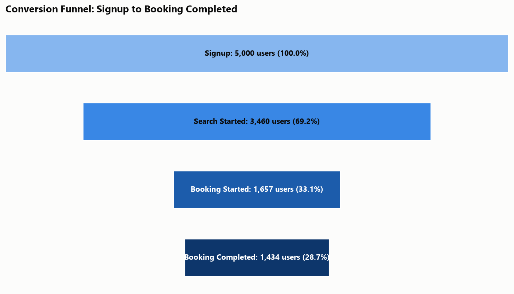
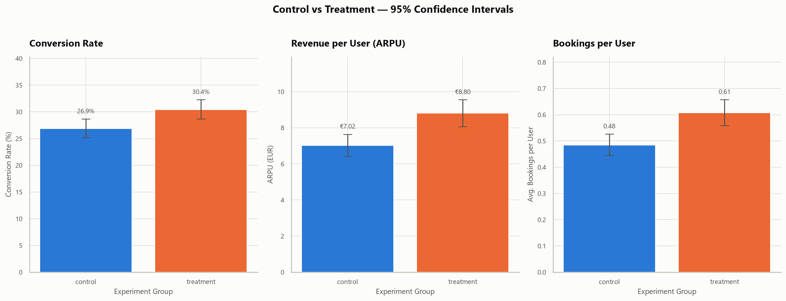
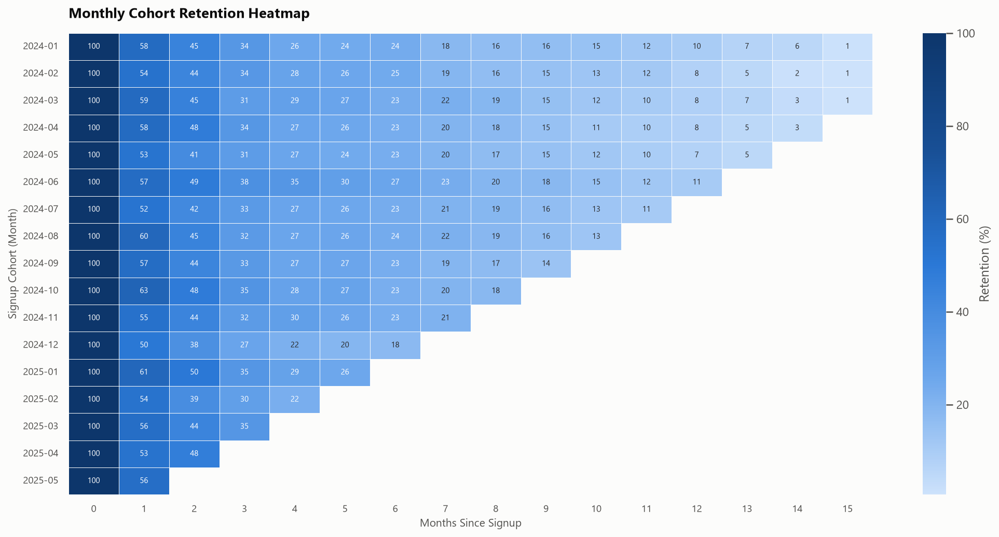
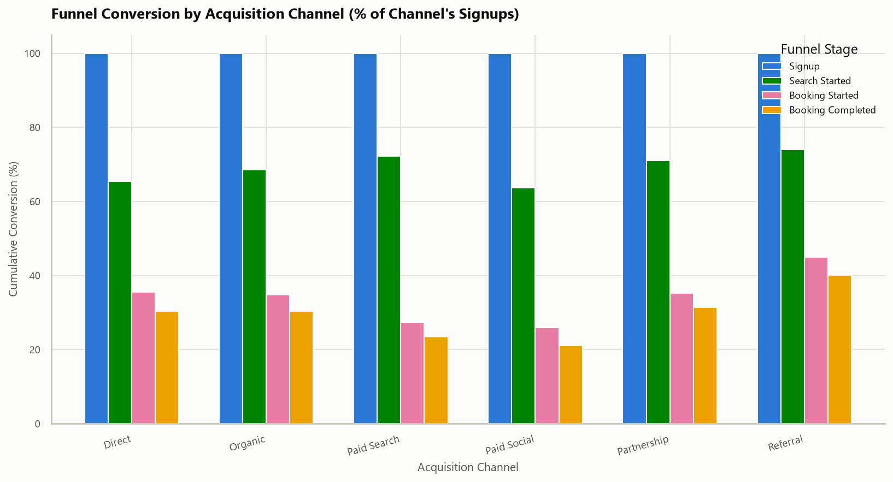

# Product Analytics Case Study: Funnel, Retention, Cohorts & A/B Testing

**SQL · Python · Power BI · Statistics** | Sara Hosseini, Data Analyst, Berlin

An end-to-end product analytics project for a simulated European mobility app. It starts with business questions, runs the analysis in SQL and Python, checks data quality with automated tests, evaluates an experiment with significance testing, and finishes with a Power BI report and recommendations.

> **Synthetic data:** I generated all data for this project with a fixed random seed (no real users, no personal data). The findings show the analytical method, not real commercial results.

---

## 30-Second Overview

| Evidence | Where to find it |
|---|---|
| **10 SQL analysis scripts** (~1,750 lines): KPIs, funnel, retention, cohorts, segmentation, A/B test, using CTEs and window functions | [`sql/`](sql) |
| **6 Python notebooks**: EDA, retention curves, funnel by segment, z-test and Welch t-test with 95% CIs | [`notebooks/`](notebooks) |
| **6-page Power BI report** with about 30 DAX measures (D1/D7/D30 retention, ARPU uplift, funnel rates) | [`dashboard/Product_Analytics_Dashboard.pbix`](dashboard) |
| **Data quality**: 23 validation checks and 25 pytest tests, all passing | [`src/validate_data.py`](src/validate_data.py), [`tests/`](tests) |
| **Written findings & recommendations** | [`insights/phase2_summary.md`](insights/phase2_summary.md) |
| **Case study page** | [sara-hosseini.github.io/project-analytics.html](https://sara-hosseini.github.io/project-analytics.html) |

<table>
<tr>
<td width="50%"></td>
<td width="50%"></td>
</tr>
<tr>
<td width="50%"></td>
<td width="50%"></td>
</tr>
</table>

<!-- TODO: add Power BI page screenshots exported from the .pbix (images/powerbi_*.png) -->

---

## Business Questions

1. Where do users abandon the booking journey?
2. Which acquisition channels and platforms deliver valuable users?
3. How do monthly signup cohorts retain, and which behaviours go with retention?
4. Did the simplified booking flow improve conversion enough to roll out?

## Dataset

| Table | Rows | Grain |
|---|---:|---|
| `users` | 5,000 | one row per user (country, platform, channel, age group, experiment group) |
| `events` | 141,813 | one row per event (15 event types, from `app_open` to `booking_completed`) |
| `experiments` | 5,000 | one row per user in the `simplified_booking_flow` test |

Period: January 2024 to June 2025. Full data dictionary: [`data/README.md`](data/README.md).

---

## Key Findings

| Metric | Value |
|---|---:|
| Completed bookings | 2,731 |
| Simulated revenue | €39,589.80 |
| User conversion (≥1 booking) | 28.7% |
| ARPU | €7.92 |
| Day 1 / Day 7 / Day 30 retention | 10.2% / 9.3% / 7.1% |

**1. The biggest leak is search to booking, not checkout.** 69.2% of users search, but only 33.1% start a booking, a 52.1% drop-off. Once a booking is started, 86.5% complete it. The opportunity is in search and comparison.

**2. Channel quality matters more than volume.** Referral users convert at 40.0% with an ARPU of €13.03. Paid Search converts at 23.5% (ARPU €5.43) and Paid Social at 21.0%.

**3. Web lags the apps.** Conversion is 30.0% on iOS, 28.8% on Android and 24.0% on Web.

**4. Engagement features go with retention, but the link is observational.** Day 30 retention rises from 2.0% for users who adopted none of three engagement features to 14.7% for users who adopted all three. That is a correlation, so it should be tested before anyone claims an effect.

**5. The experiment worked.** The simplified booking flow lifted conversion from **26.9% to 30.4% (+3.6 pp, z = 2.78, p < 0.01)** and ARPU from €7.02 to €8.80.

### Recommendations

1. Prioritise the search-to-booking step and the Web journey.
2. Shift acquisition budget towards Referral and tighten Paid Search targeting. Judge channels on conversion and ARPU, not signups.
3. Roll out the simplified booking flow and keep monitoring conversion and ARPU.
4. Test engagement prompts in a controlled experiment before investing heavily.

---

## SQL Highlight: Funnel Drop-off with Window Functions

From [`sql/04_funnel_analysis.sql`](sql/04_funnel_analysis.sql):

```sql
WITH funnel_counts AS (
    SELECT 'signup' AS stage, 1 AS stage_order, COUNT(*) AS users_reached FROM users
    UNION ALL
    SELECT 'search_started', 2, COUNT(DISTINCT user_id) FROM events WHERE event_name = 'search_started'
    UNION ALL
    SELECT 'booking_started', 3, COUNT(DISTINCT user_id) FROM events WHERE event_name = 'booking_started'
    UNION ALL
    SELECT 'booking_completed', 4, COUNT(DISTINCT user_id) FROM events WHERE event_name = 'booking_completed'
),
funnel_with_lag AS (
    SELECT stage, stage_order, users_reached,
           LAG(users_reached)         OVER (ORDER BY stage_order) AS prev_stage_users,
           FIRST_VALUE(users_reached) OVER (ORDER BY stage_order) AS top_of_funnel_users
    FROM funnel_counts
)
SELECT stage, users_reached,
       ROUND(100.0 * users_reached / top_of_funnel_users, 1)                 AS pct_of_top,
       ROUND(100.0 * (prev_stage_users - users_reached) / prev_stage_users, 1) AS drop_off_pct
FROM funnel_with_lag
ORDER BY stage_order;
```

| stage | users_reached | pct_of_top | drop_off_pct |
|---|---:|---:|---:|
| signup | 5,000 | 100.0 | – |
| search_started | 3,460 | 69.2 | 30.8 |
| booking_started | 1,657 | 33.1 | **52.1** |
| booking_completed | 1,434 | 28.7 | 13.5 |

### SQL script index

| Script | Purpose |
|---|---|
| `00_schema.sql` | Tables, keys and indexes |
| `01_data_quality.sql` | Nulls, duplicates, orphan keys, date and revenue rules |
| `02_business_overview.sql` | Users, events and bookings by segment |
| `03_kpi_dashboard.sql` | Conversion, ARPU, ARPPU, AOV and monthly KPIs |
| `04_funnel_analysis.sql` | Funnel, drop-off and abandonment points |
| `05_retention.sql` | D1/D7/D30 retention and churn |
| `06_cohort_analysis.sql` | Monthly signup cohorts |
| `07_feature_adoption.sql` | Feature adoption and retention |
| `08_segmentation.sql` | Channel, platform and country segments |
| `09_ab_testing.sql` | Experiment sample sizes, uplift and z-statistic |
| `10_business_recommendations.sql` | Metrics behind each recommendation |

---

## Power BI Report

Six pages: **Executive Overview** (KPI cards, trends, slicers), **User Behaviour**, **Product Funnel**, **Retention Analysis** (cohort matrix, D1/D7/D30), **Experiment Analysis** (control vs treatment, uplift) and **Executive Recommendations**.

Example DAX measures: `Day 7 Retention %`, `Cohort Retention %`, `Booking Start Rate %`, `Abandonment Rate %`, `Experiment Uplift pp`, `ARPU Uplift %`.

Open [`dashboard/Product_Analytics_Dashboard.pbix`](dashboard) in Power BI Desktop (free, Windows).

---

## How to Reproduce

Requires Python 3.10+.

```bash
git clone https://github.com/Sara-Hosseini/product-analytics-case-study.git
cd product-analytics-case-study
pip install -r requirements.txt

python src/generate_data.py      # recreates data/raw/*.csv (seed 42, identical output)
python src/validate_data.py      # 23 data-quality checks
python -m pytest tests           # 25 automated tests
python src/build_database.py     # builds data/processed/analytics.db (SQLite)
python src/run_sql.py sql/04_funnel_analysis.sql   # run any analysis script
jupyter notebook notebooks/      # notebooks 01–06
```

## Repository Structure

```text
product-analytics-case-study/
├── data/          raw CSVs + data dictionary
├── src/           data generation, validation, database build, SQL runner, EDA helpers
├── sql/           10 analysis scripts (+ schema)
├── notebooks/     6 analysis notebooks
├── images/        36 exported charts
├── dashboard/     Power BI report (.pbix)
├── insights/      written findings
└── tests/         pytest data-quality suite
```

## Tech Stack

SQL (SQLite) · Python (pandas, NumPy, SciPy, Matplotlib, Seaborn) · Power BI (DAX) · pytest · Jupyter · Git

## Next Steps

- Move the SQL layer to a cloud warehouse (BigQuery or Snowflake) and model it with dbt
- Add drill-through pages to the Power BI report
- Add a power analysis (minimum detectable effect) to the experiment section

---

**Sara Hosseini** · Data Analyst · Berlin
[LinkedIn](https://www.linkedin.com/in/sara-hosseini-analyst/) · [Portfolio](https://sara-hosseini.github.io/) · [GitHub](https://github.com/Sara-Hosseini) · sarahosseinigh@gmail.com
